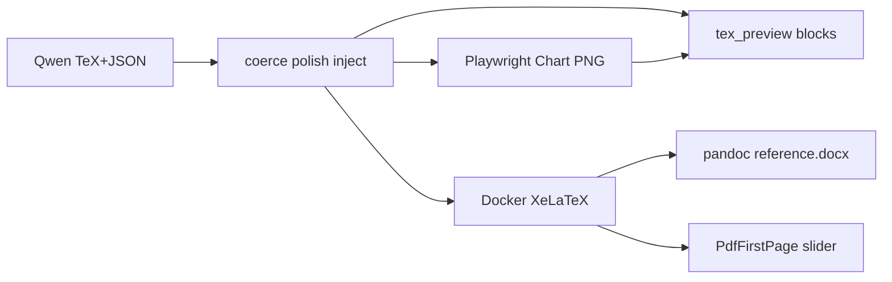

# Liber: графики · чат · документы — план улучшений

## Контекст (как сейчас)

- Чат: Liber-карточка из TeX-блоков (`tex_preview.py` + `ReportView.tsx`) — не PDF.
- График: статичный PNG; «Изменить» → sheet → часто LLM + полный PDF/DOCX (`chart_edit.py`).
- PDF: DejaVu + fancyhdr (`tex_preamble.py`); DOCX: тонкий Times `assets/docx/reference.docx`.

Ограничение: всё должно жить на винде с Qwen и кастомным Image API — без новых native-зависимостей, без ломки `scripts\api.cmd` / `web.cmd`.

**Стратегия по умолчанию:** баланс (по удару из каждого блока), не «только графики».

---

## 1. Графики — расширенный список

| # | Идея | Effort | Зачем |
|---|------|--------|-------|
| G1 | Починить hover chip (`pointer-events` + fallback `META[type]`) | S | Мерцание / crash |
| G2 | Seed палитры sheet из last-edit / figure, не только global | S | Честный «Изменить» |
| G3 | Local-first смена типа (coerce без LLM, LLM только если нужно) | M | Быстрее и дешевле на винде |
| G4 | KPI красить из палитры | S | Палитра не no-op |
| G5 | Style chips → детерминированные патчи HTML | M | Меньше LLM |
| G6 | «Только PNG» / docs async после edit | M | Меньше ожидания |
| G7 | Отмена гонок render в PDF-слайдере | S | Корректное листание |
| G8 | Умный дефолт типа по данным (месяцы→line/bar) | S–M | Меньше странных hbar |
| G9 | Live preview (iframe Chart.js / мини-PNG) до Apply | L | Главный UX-win |
| G10 | Сильные type-transforms (donut↔bar datasets) | L | Надёжная смена типа |
| G11 | Per-figure lock (не блокировать все «Изменить») | M | Мульти-графики |
| G12 | Tooltip/значения: live Chart.js в чате (не только PNG) | L | Наведение на данные |

---

## 2. Чат — расширенный список

| # | Идея | Effort | Зачем |
|---|------|--------|-------|
| C1 | Списки `itemize`/`enumerate` → блоки `<ul>`/`<ol>` | S | Сейчас сплющиваются в prose |
| C2 | `\textbf`/`\textit` → strong/em в превью | S | Акценты живы в PDF, мертвы в чате |
| C3 | Пустой preview + есть PDF → явный warning | S | Не «тело пустое» молча |
| C4 | `\subsubsection` + longtable / bare tabularx | M | Плотнее паритет с TeX |
| C5 | Nested `\caption{…}` parser | M | Не терять подписи |
| C6 | User bubble: свернуть Intent, чипы настроек | M | Читаемый запрос |
| C7 | Sticky TOC якоря по section | S–M | Длинные отчёты |
| C8 | Ошибка: latex log tail + «график N упал» | M | Диагностика |
| C9 | Print-mode toggle (белый лист ближе к PDF) | M | Меньше «два мира» |
| C10 | Jump: клик по рис. → страница PDF-слайдера | L | Связка чат↔PDF |
| C11 | Коллапс секций | S | Меньше скролла |
| C12 | Копировать раздел в буфер | S | Для переписки |

---

## 3. Документы — расширенный список

| # | Идея | Effort | Зачем |
|---|------|--------|-------|
| D1 | `reference.docx`: Heading3, List, Quote; шрифт = Liberation/DejaVu (не Times) | S | Убрать тройной раскол шрифтов |
| D2 | Caption grammar «Рис.» / «Таблица» + captionsetup | S | Единый язык |
| D3 | Титул-шаблон: title + пустой author + дата | S | Меньше хаоса модели |
| D4 | REPORT_STYLE: rule под title, float spacing | M | Liber-print look |
| D5 | Post-pandoc table polish (header row, numeric align) | M | DOCX таблицы |
| D6 | Prompt: списки/emphasis first-class | M | Кормит и чат, и PDF |
| D7 | Лимиты высоты/ширины графиков на A4 | M | Не раздувать страницу |
| D8 | DOCX header ≈ fancyhdr | M | Паритет шапки |
| D9 | 2 стиля отчёта (Liber / строгий) в Settings | M–L | Выбор вида |
| D10 | Shared design tokens (палитра UI=charts=print) | L | Единый бренд |
| D11 | Visual regression PDF pages на fixtures | L | Не ломать вёрстку |
| D12 | Wide-table / orphan `&` — уже частично; добить edge cases | M | Надёжность сдачи |

---

## Фазы реализации

### Фаза 0 — Quick wins (1–2 дня)
- G1, G2, G4, G7
- C1, C2, C3
- D1, D2, D3  
Проверка: `pytest` + `web npm run build` + smoke отчёт на винде.

### Фаза 1 — Скорость edit + читаемый чат (2–4 дня)
- G3 local-first type, G5 style chips, G6 PNG-first edit, G8 smart type
- C6 user chips, C7 TOC, C8 error tail, C11 collapse
- D4 style block, D6 prompt lists, D7 chart size

### Фаза 2 — Паритет и «вау» (позже)
- G9 live preview, G12 live Chart.js tooltips
- C9 print-mode, C10 jump to PDF page
- D5/D8 DOCX polish, D9 report styles, D10 tokens

---

## Ключевые файлы

| Зона | Файлы |
|------|--------|
| Графики UI | `web/src/ChartEditSheet.tsx`, `ChartTypePreview.tsx`, `ReportView.tsx`, `PdfFirstPage.tsx` |
| Графики backend | `src/case3/chart_edit.py`, `chart_types_coerce.py`, `chart_style.py` |
| Чат | `web/src/App.tsx`, `ReportView.tsx`, `styles.css`, `tex_preview.py` |
| Документы | `tex_preamble.py`, `render.py`, `assets/docx/reference.docx`, `prompt/system_tex.md` |

## Критерии готовности фазы 0

1. Hover chip не мерцает / не падает на неизвестном type.
2. Списки и bold/italic видны в чате на gold-like TeX.
3. DOCX не в Times при открытии на винде; caption «Рис.» единообразно.
4. PDF-слайдер не показывает чужую страницу при быстром ←→.
5. Регрессии: существующие pytest зелёные; `npm run build` ok.

## Future note (не в скоупе сейчас)

PPTX как третий артефакт — отдельный дизайн; см. обсуждение 2026-10-20 (python-pptx + slide JSON + готовые master-слайды, не «Qwen пишет весь PPTX с нуля»).
