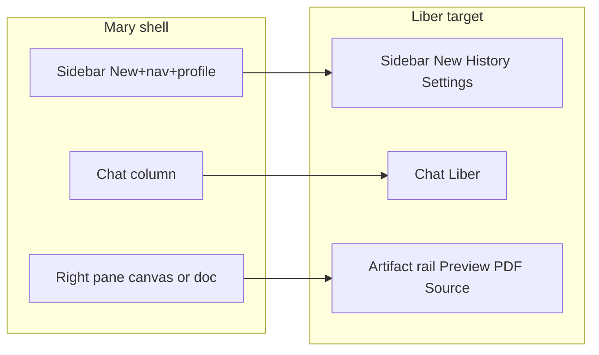

# Liber Soft-Premium UI — план продукта

Using brainstorming + frontend-design + agent audits ([Liber UI](643090dc-15d8-44b1-acc4-a7c6fba09840), [Charts](b3e1bf07-01ec-434f-896c-4b7eb1b38f0e), [Mary DS](62036ed8-e8f3-45b3-9839-c0a6bdd567c2)).

## Зафиксированные решения (без развилок)

| Решение | Выбор |
|---------|--------|
| Layout | Гибрид Mary: **левый Liber-sidebar** + chat + **Artifact rail** справа (ADR-0003 сохраняем) |
| Empty | Mary-hero: mark + 1 headline + pill composer + 2–3 suggested prompts (не dashboard) |
| Цвет UI | Soft sage/mint поверх Liber olive; убрать тяжёлый foil/noise |
| Графики v1 | **Premium layout вшит в Playwright PNG** (`chart_frame`) → PDF = чат; вокруг PNG — `ChartCard` (title / insight / highlights из Source) |
| Live Chart.js hover | Фаза 2 (после shell), не блокер v1 |
| История сайдбара | **Локальный** список последних отчётов (`sessionStorage`), без нового backend API |
| Бренд | Liber Atelier (не Mary/подель); шрифты **DM Sans + Crimson** остаются |
| Функции | Все текущие knobs/API/edit/Export/rail — сохранить |

**YouTube** [KEspdAcdhwU](https://www.youtube.com/watch?v=KEspdAcdhwU) = *Julius AI* review (не Mary; см. [YouTube research](ab6ed8ff-7015-4f0c-8dc1-ff2766520ddb)). Mary = visual soft-UI; Julius = behavior of chat + RHS artifact.

### Julius → Liber acceptance (обязательно в фазах)

1. Chat = control surface; RHS rail = verify artifact before trust.
2. Visible pipeline stages (уже `PipelineFlow`) — не blank spinner; quieter Mary-style thinking bar сверху.
3. Macro edits via chat/settings; micro chart edit в sheet у фигуры (как сейчас) — не «ещё один agent turn».
4. Export = one-click PDF/DOCX (`ExportMenu`), никогда «напиши export в чат».
5. Source fidelity UX: plaque + Source tab + «числа только из Source» на ChartCard.
6. Preview ≠ PDF: явный hint в UI (PDF = истина печати).
7. KPI-first hierarchy в chart cards (Phase 2).
8. Один primary output = PDF; charts/images = rail chips, не tool dashboard.

---

## 1. Анализ Mary (из скринов + maryrose.by)

**Продукт Mary:** salon automation chat. **Для Liber берём patterns, не IA салона.**



**Что копируем structurally**

1. Floating soft window на quiet desk (большой radius, воздух).
2. Sidebar: New Chat pill, thin stroke icons, collapse, user footer.
3. Empty hero по центру + pill composer.
4. User = soft bubble справа; AI = текст без bubble + avatar слева.
5. Thinking над composer («думает… · N сек»).
6. Chart-as-answer card: KPI header / donut center% / legend label+value+% / insight line.
7. Quiet tabs + Export ▾ в правом pane.
8. Feedback row (copy / 👍 / 👎) — опционально v1.5.

**Что не копируем**

- Nav Automations / Employees / Connections / mindmap / Telegram steps.
- Periwinkle/purple chart mono.
- Маскот / marketing copy.
- Rainbow category pills.

**Chart anatomy (must-have)**

- **Donut:** cutout ~60%, center `51%` + short label, legend rows `● label  %  abs`, focus = darkest olive.
- **Stacked:** eyebrow + big KPI + context line → bars → multi-col legend with Br/values.
- Mono **luminance ladder** на карточку (не радуга).

---

## 2. Текущий Liber (gap)

| Уже есть (сохранить) | Gap vs Mary-premium |
|----------------------|---------------------|
| Chat-first + Artifact rail | Нет left sidebar |
| PipelineFlow, SettingsModal, Export | Composer не pill; emoji 📎 |
| PNG charts + ChartEditSheet | Нет center%/KPI header/valued legend в PNG |
| 9 types, 5 palettes (`atelier` soft olive) | Chat = caption under img only |
| Framer motion + reduced-motion | Слишком плотный cream/foil/noise |
| sessionStorage last report | Нет списка истории в UI |

Ключевые файлы: [`web/src/App.tsx`](web/src/App.tsx), [`web/src/styles.css`](web/src/styles.css), [`web/src/ArtifactRail.tsx`](web/src/ArtifactRail.tsx), [`web/src/ReportView.tsx`](web/src/ReportView.tsx), [`src/case3/templates/chart_frame.html`](src/case3/templates/chart_frame.html), [`src/case3/chart_style.py`](src/case3/chart_style.py), [`prompt/system_tex.md`](prompt/system_tex.md).

---

## 3. Design system — Soft Liber Green

Новые токены в `:root` ([`web/src/styles.css`](web/src/styles.css)):

- Desk: `--bg-app #F0EDE4`, sage wash (не lilac).
- Surfaces: `--surface #FFFCF7`, `--surface-2 #F2EFE6`, `--surface-3 #E8F0E4`.
- Ink ladder: `--ink / --ink-2 / --muted / --muted-2`.
- Accent: keep olive `#3F5210` + softer mid `#6B7F3A`.
- Chart ladder: `--chart-1…4` olive luminance.
- Radius: `--radius-lg 24px`, `--radius-xl 28–32px`, pill sparingly.
- Shadow: Mary-flat (`--shadow-card`); меньше `--shadow-lift` / foil.
- Icons: единый stroke set (Lucide-style SVG, 1.5–1.75), **без emoji**.

**Палитры charts (backend):** переработать все 5 в softer ladders; **`atelier` = default soft-green primary**; sync UI swatches + `system_tex.md` AUTO list (сейчас atelier частично выпадает из prompt). KPI colors в frame — из palette, не hardcoded orange.

---

## 4. Target IA (сохраняем функции)

```text
┌─ LiberShell (glass) ─────────────────────────────────────┐
│ Sidebar │ ChatColumn              │ ArtifactRail         │
│ New     │ Empty | Messages        │ Preview · PDF · Src  │
│ History │ ArtifactCard / ChartCard│ Export · TOC · resize│
│ Settings│ PipelineFlow            │                      │
│ (user)  │ ComposerDock (pill)     │                      │
└──────────────────────────────────────────────────────────┘
```

**Sidebar items (Liber, не Mary):** Новый отчёт · История (local) · Настройки. Collapse icon-only. Footer: «Liber Atelier» mark (не fake user profile, если нет auth).

**Composer:** `+` attach · textarea · send ↑; Settings gear в sidebar или topbar; ContextPlaque / photo chips над bar.

**Thinking:** timer над composer + существующий `PipelineFlow` quieter в thread.

---

## 5. Chart upgrade (ядро «вау»)

### 5.1 Bake into PNG (print truth)

Расширить [`chart_frame.html`](src/case3/templates/chart_frame.html) + recipes в prompt / coerce:

1. **Donut layout:** CSS grid canvas | HTML legend; center overlay `%` + label (без Chart plugins — HTML поверх, CSP-safe).
2. **Stacked/KPI header:** eyebrow + big number + context strip над `#mount`.
3. **Legend valued:** rows из parsed datasets (label, value, pct) — генерировать HTML в coerce/polish или требовать от LLM fragment.
4. **Bar/line:** value labels where density allows; rounded tops; soft grid.
5. **KPI cards:** multi-KPI row, palette-driven ink (roadmap G4).

### 5.2 Chat `ChartCard`

Новый компонент вокруг figure в [`ReportView.tsx`](web/src/ReportView.tsx):

- Title (caption / schema `title`)
- PNG (premium already)
- Optional `insight` + `highlights[]` from extended charts schema
- Edit sheet / lightbox без регрессий

Schema extension (минимально): `title?`, `insight?`, `highlights?: [{label,value,pct?}]` в parse → `tex_preview` → UI. Числа **только из Source** (prompt invariant).

### 5.3 Types

Whitelist **сохранить** 9 types; «новые» = presentation modes, не обязательно новые Chart.js types:

- Donut answer card
- Stacked expense card  
- KPI strip
- (опционально v1.5) funnel-as-horizontal_bar recipe с ranked legend

Edit/regenerate: существующий `POST …/charts/{id}/edit` + polish frame — без ломки API.

### 5.4 Phase 2 charts (после shell)

- Live Chart.js tooltips в Preview (roadmap G12)
- Legend↔segment hover
- Local-first type change (G3), live preview in sheet (G9)

---

## 6. Motion & polish

| Moment | Spec |
|--------|------|
| Shell enter | fade + slight rise |
| Sidebar collapse | width spring 350ms |
| Rail open/close | existing Framer; quieter |
| Message enter | keep layout animation; убрать dual CSS+Framer conflict |
| Thinking dots | opacity stagger |
| Chart card enter | opacity + translateY 12px |
| `prefers-reduced-motion` | уже есть — сохранить |

---

## 7. Фазы реализации

### Phase 0 — Design tokens + shell skin (~1–2 дня)
- Rewrite `:root` soft-green; glass desk; prune dead `.panel` CSS
- Pill composer + SVG icons
- Empty hero (Liber copy)
- Soften ArtifactCard / rail chrome / bubbles
- **Verify:** `npm run build`, visual empty+chat smoke, все send/attach/settings работают

### Phase 1 — Liber sidebar + history local (~1 день)
- `AppShell` / `Sidebar` / extract from God-`App.tsx` (логика run/poll не ломать)
- New report clears thread; History = list last N from sessionStorage
- Settings entry from sidebar
- **Verify:** restore last report, rail width, Esc overlay

### Phase 2 — Premium charts PNG + ChartCard (~2–3 дня)
- `chart_frame` layouts donut/stacked/KPI
- Palette soften + KPI palette apply
- Prompt recipes + parse fields
- `ChartCard` UI + edit still works
- **Verify:** pytest coerce/palette/harden; offline PNG fixtures; one live Qwen run on desk

### Phase 3 — Chat answer quality + motion (~1–2 дня)
- Thinking bar above composer
- Roadmap C1/C2 lists/emphasis in preview
- Feedback icons (copy first; thumbs optional)
- Motion pass + reduced-motion QA
- **Verify:** gold TeX preview; screenshot checklist vs Mary structure (not brand)

### Phase 4 — Docs L3
- Spec: `docs/superpowers/specs/2026-10-21-liber-soft-premium-ui-design.md`
- Plan file (этот) → `docs/superpowers/plans/…`
- ADR-0006 soft-premium shell; update KI-liber-ui + KI-charts
- Fold parked UX roadmap items that this supersedes

---

## 8. Component / file map

**New (web):** `AppShell.tsx`, `Sidebar.tsx`, `EmptyState.tsx`, `ComposerDock.tsx`, `TopBar.tsx` (thin), `ChartCard.tsx`, `icons.tsx`, hooks `useRunPipeline` / `useSourceIngest` (по мере split).

**Restyle:** `ArtifactRail`, `ArtifactCard`, `ContextPlaque`, `SettingsModal`, `PipelineFlow`, `ExportMenu`, `ChartEditSheet`, `ReportView`.

**Backend:** `chart_frame.html`, `chart_style.py`, `chart_types_coerce.py`, `parse_output.py`, `tex_preview.py`, `prompt/system_tex.md`, tests under `tests/`.

**Do not break:** FormData fields, poll machine, editLock, `liber-rail-width`, caption-without-type-badge, `formats: both`, pdfjs lazy.

---

## 9. Anti-slop / QA gates

1. Нет purple neural gradients / Inter-as-brand / emoji chrome.
2. Pills budget: composer + ≤3 empty prompts.
3. Preview ≠ PDF только по layout TeX; **chart PNG идентичен**.
4. Числа в insight/highlights — из Source.
5. Windows desk: `api.cmd` / `web.cmd` без новых native deps.
6. `pytest` + `web npm run build` зелёные перед «готово».

---

## 10. Оценка

~6–9 рабочих дней end-to-end (Phase 0–3); Phase 4 docs в тот же цикл. Можно шипить по фазам: после Phase 0 уже «новый look», после Phase 2 — «Mary-level charts».
